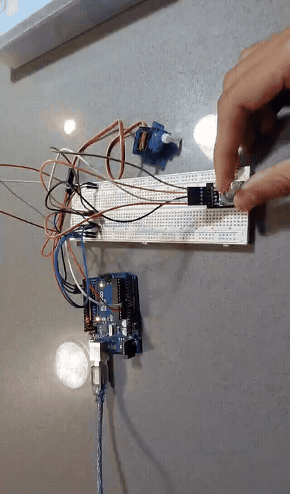

# Rotary Encoder-Based Servo Motor Controller

A beginner Arduino robotics project that uses a KY-040 rotary encoder to control the position of an SG90 servo motor.

## Demo



## Features

- **Clockwise Rotation:** Increases the servo angle by 5°.
- **Counterclockwise Rotation:** Decreases the servo angle by 5°.
- **Button Press:** Resets the servo position to 90°.
- **Angle Limiting:** Keeps servo movement between 0° and 180°.

## Hardware Used

| Component | Description |
|---|---|
| Arduino Uno R3 | Main microcontroller |
| KY-040 Rotary Encoder | Detects rotational direction and button presses |
| SG90 Micro Servo | Controls rotational position |
| Breadboard | Circuit connections |
| Jumper Wires | Electrical connections |
| USB Cable | Arduino programming and power |

## Pin Connections

### Rotary Encoder (KY-040)

| Encoder Pin | Arduino Pin |
|---|---|
| CLK | D2 |
| DT | D3 |
| SW | D4 |
| + (VCC) | 5V |
| GND | GND |

### Servo Motor (SG90)

| Servo Wire | Arduino Connection |
|---|---|
| Orange/Yellow (Signal) | D9 |
| Red (VCC) | 5V |
| Brown (GND) | GND |

## Software & Libraries

- **Programming Language:** C++
- **IDE:** Arduino IDE
- **Library:** Arduino Servo Library

## How It Works

The KY-040 rotary encoder detects the direction of rotation using its CLK and DT signals.

The Arduino reads these signals and adjusts the servo motor's position accordingly:

1. Rotating clockwise increases the servo angle by 5 degrees.
2. Rotating counterclockwise decreases the servo angle by 5 degrees.
3. Pressing the encoder button resets the servo to 90 degrees.

The `constrain()` function ensures that the servo angle stays within the 0°–180° range.

## Project Structure

```text
Rotary-Encoder-Servo-Controller/
│
├── README.md
├── demo.gif
└── ServoController.ino
```


**Project Status:** Completed

**Built with:** Arduino Uno R3 | KY-040 Rotary Encoder | SG90 Servo Motor
